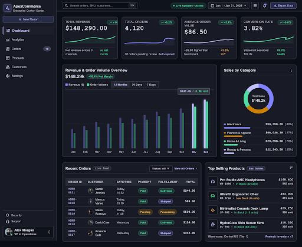

# ApexCommerce — E-Commerce & Sales Analytics Dashboard

A modern, high-density desktop e-commerce and revenue telemetry dashboard designed with **Stitch** following the *ApexCommerce Observability & Operations* enterprise dark theme design system.

## 🚀 Live Demo
- **GitHub Pages:** [https://locus-basanta.github.io/ecommerce-dashboard/](https://locus-basanta.github.io/ecommerce-dashboard/)
- **Cloudflare Workers:** [https://apexcommerce.manwanepal.workers.dev](https://apexcommerce.manwanepal.workers.dev)

## ✨ Features
- **Collateral Navigation Sidebar:** Compact 240px navigation dock with live store switcher and real-time operational links.
- **Header Controls:** Global search with `⌘K` keyboard shortcut, date range picker, live sync indicator (`18ms`), and CSV report export.
- **4 Key Telemetry Metrics:**
  - Total Revenue: `$148,290.00` (`+14.8%`)
  - Total Orders: `4,120` (`+9.2%`, ~137/day)
  - Average Order Value: `$86.50` (`+3.4%`)
  - Conversion Rate: `3.82%` (`+0.6%`)
- **Visual Analytics:**
  - Revenue & Order Volume 30-day comparative area curve.
  - Category sales distribution breakdown (Electronics 38%, Apparel 27%, Home 20%, Beauty 15%).
- **Data Tables & Inventory:**
  - Recent customer orders live feed with fulfillment status pill badges.
  - Ranked SKU velocity list with low-stock reorder alerts.

## 🛠 Tech Stack
- HTML5 & CSS3
- Tailwind CSS
- Inter font with tabular figures (`tnum`, `cv05`)
- Inline vector SVGs
